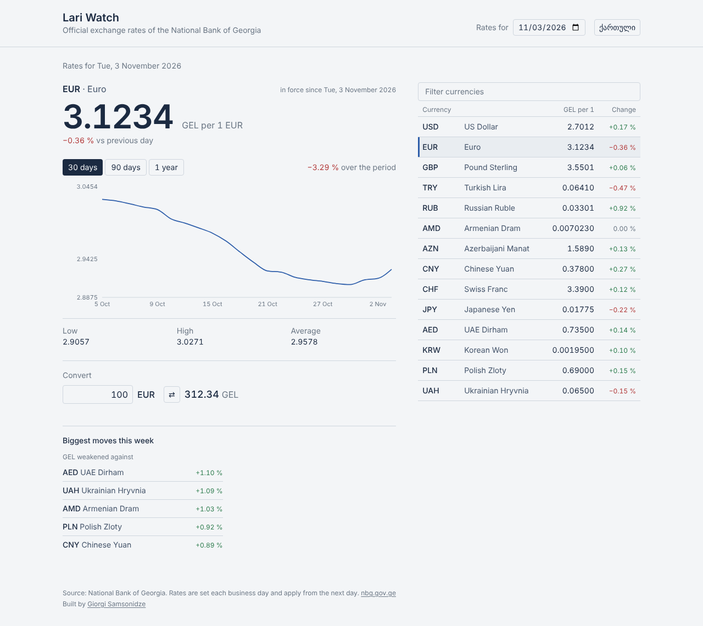

# Lari Watch

Official lari (GEL) exchange rates from the National Bank of Georgia: today's rate for every currency, how it moved over the last month, quarter or year, and a converter. English and Georgian.

[](https://github.com/samsonidze/lari-watch/actions/workflows/ci.yml)

**Live:** https://lari-watch.vercel.app



## What it does

- **Every NBG currency, today or any past date.** Rates are shown per one unit even where the bank quotes per 100 or 1000 (JPY, KRW, UZS…), with the original quote alongside.
- **History for 30 days, 90 days or a year** with low, high, average and the change over the period.
- **Day-on-day change** from the bank's published difference.
- **Biggest moves this week** — the currencies the lari weakened and strengthened against most over the last five business days.
- **Converter** in both directions for the selected currency.
- **Shareable views:** `?cur=EUR&date=2026-03-01` is a link to that currency on that day.
- Georgian and English (the bank supplies localised currency names), light and dark, keyboard-navigable, no animation.

## How it's built

React 18 · TypeScript · Vite · Tailwind CSS 4 · TanStack Query · Recharts · Vitest · Vercel Functions

```
api/            Vercel function entry points (thin adapters)
server/
  nbg.ts        NBG client: URL building, validation, business-day calendar, history fan-out
  handlers.ts   /api/rates and /api/history as plain functions (no framework types)
  vite-plugin   Mounts the same handlers in `vite dev`, so dev and prod run one implementation
src/
  api/          fetch wrappers + TanStack Query hooks
  lib/          formatting (Intl), stats, i18n strings, currency ordering
  components/   Header, RatesList, CurrencyDetail, RateChart (lazy), Converter, Movers
```

### Why there's a server at all

The NBG endpoint returns one calendar day per request. A one-year chart therefore needs ~260 requests (business days only), which is too much to do from each visitor's browser and would hammer the bank's API. `/api/history` fans those requests out with a concurrency limit, aligns every currency onto one date axis (gaps stay gaps, they're not interpolated), and the result is cached at Vercel's edge for six hours. `/api/rates` is a plain proxy with a short cache for today and a long one for past days, which never change.

"Today" on the server is the date in Tbilisi, not UTC — the bank publishes against local time, and a request made late in the evening from a browser (or a function running in another region) would otherwise ask for the wrong day.

### Tests

`npm test` covers the parts that are easy to get subtly wrong: date validation, the business-day calendar, the concurrency limiter, series alignment with missing days, cache headers, the Tbilisi midnight rollover, and the percentage maths. The handlers take an injectable `fetch`, so the tests run against a fake bank without network access.

## Run it

```bash
npm install
npm run dev        # http://localhost:5173 — /api/* served by the Vite plugin
npm test
npm run build
```

Deploying to Vercel needs no configuration and no environment variables; the `api/` folder becomes two serverless functions.

## Data

[National Bank of Georgia — official exchange rates](https://nbg.gov.ge/en/monetary-policy/currency). Rates are set each business day and come into force the following day. The bank's API is public and keyless; this project caches it and does not redistribute it beyond what the page shows.

## Ideas for later

- Cross rates (EUR→USD via GEL) and a multi-currency compare chart
- A `Range` of "since 1 Jan" and "since a date I pick"
- Notifications when a currency crosses a threshold
